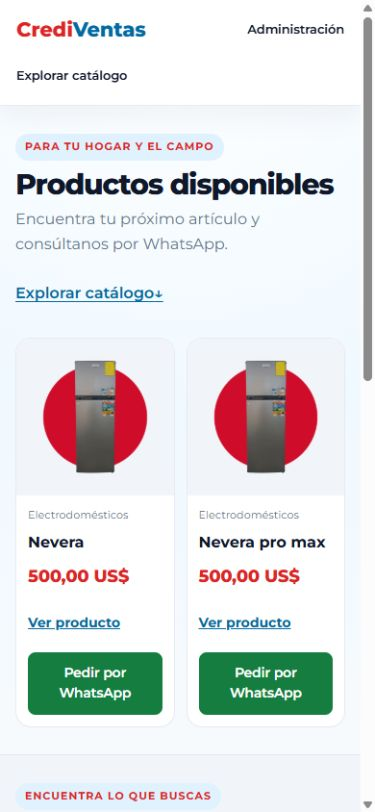
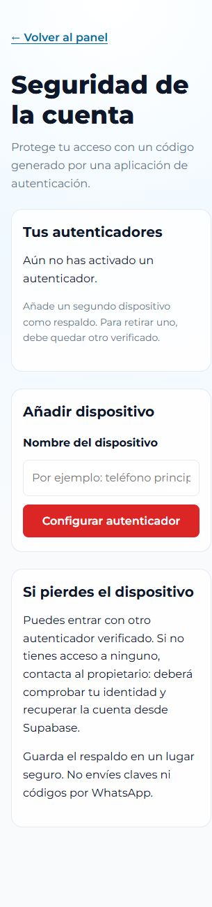
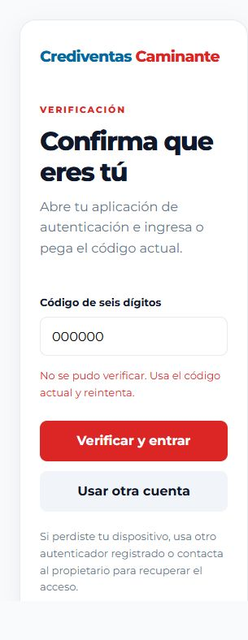

# Correcciones y comprobaciones — 5 de octubre de 2026

Este documento actualiza el estado de la [auditoría inicial](AUDITORIA-2026-10-05.md). La auditoría original se conserva como registro histórico.

## Aplicado

| Área | Corrección |
| --- | --- |
| Dependencias | Angular/CLI/build 22.2.1 y lockfile actualizado; Supabase JS y compresor con versión exacta. |
| Acceso | Guard con usuario validado por Auth y rol en app_metadata; rechazo de cuentas comunes y reacción a pérdida de sesión. |
| MFA | Pantalla de configuración TOTP, desafío tras el login y protección RLS para cuentas administrativas con un factor verificado. |
| Login e inventario | Estado reactivo después de operaciones asíncronas, errores visibles y bloqueo de envíos duplicados. |
| Contraseña de administrador | El login identifica `weak_password` y explica que el propietario debe restablecer la credencial antes de entrar. |
| Formulario | Activo/Oculto, límites de datos, especificaciones inválidas o repetidas rechazadas, categorías editables y etiquetas asociadas a IDs únicos. |
| Catálogo | Paginación y filtros en servidor, búsqueda sin tildes, conteo y limpieza de filtros, reintentos y rechazo de respuestas obsoletas. |
| Ficha | Consulta directa por ID, filtro público Activo, reacción a cambio de ID, estados de error y ausencia separados. |
| Imágenes | Compresor local, WebP y miniaturas, compensación de cargas fallidas, conservación de referencias y cola de limpieza serializada. |
| Reintentos | UUID estable al crear; recuperación de imágenes de ediciones que guardaron pero perdieron la respuesta; limpieza segura tras borrados sin confirmar. |
| Móvil/accesibilidad | Imágenes completas, contraste de WhatsApp, elementos interactivos sin anidación, anclas con espacio para cabecera, diálogo nativo, movimiento reducido y pie sin superposición. |
| Seguridad de base de datos | Permisos sobrantes revocados, RLS inspeccionada, restricciones de contenido, funciones con security invoker y search_path fijado. |
| Auditoría | Registro privado de INSERT/UPDATE/DELETE con actor, producto y fecha, sin payloads ni datos de contacto. |
| Migraciones | Esquema inicial y galería registrados; archivos alineados con versiones remotas. |
| Configuración | .env.example, generador que rechaza claves privadas, configuración local de Supabase y tipos de base generados. |
| Despliegue | Cabeceras versionadas para Vercel; CSP mínima aplicada y política completa en observación. |
| Calidad | TypeScript y plantillas estrictos, pruebas de comportamiento y workflow de aplicación/base de datos. |
| SEO/operación | Metadatos dinámicos y Product JSON-LD; diagnóstico local limitado sin datos sensibles; README y procedimiento de copias actualizados. |

La portada usa selección editorial cuando existen productos destacados. Con el catálogo actual muestra “Productos disponibles”; no afirma popularidad sin mediciones.

## Resultados comprobados

| Comprobación | Resultado |
| --- | --- |
| Compilación de producción | Correcta, sin avisos de presupuesto. Inicial: **288,92 kB**; transferencia estimada: **77,72 kB** en la última comprobación. |
| Pruebas de aplicación | **83 aprobadas en 18 archivos**. |
| npm audit | **0 vulnerabilidades conocidas** en la consulta del 5 de octubre. |
| Recurso del compresor | Presente en la salida de producción, bajo assets/vendor. |
| SQL por roles | Anónimo y cuenta común no escriben; ocultos protegidos; user_metadata falsificado no concede rol; CRUD de administrador, restricciones, búsqueda y registro de auditoría aprobados. |
| Docker desde cero | Siete migraciones aplicadas correctamente en PostgreSQL local; pruebas SQL de roles aprobadas. |
| MFA en Docker | TOTP real: enrolamiento, código erróneo, desafío tras nuevo login, dispositivo de respaldo y rechazo por RLS de un token AAL1 antiguo. |
| Auth y Storage locales | Registro cerrado, sesiones reales, autorización por rol, carga de administrador y protección/borrado de imágenes referenciadas comprobados. Cuentas, productos e imágenes temporales limpiados. |
| Reversión de pruebas remotas | Consulta posterior: **2 productos reales, 0 productos de prueba, 0 eventos de auditoría de prueba**. |
| Limpieza de pruebas locales | Consulta posterior: **0 productos, 0 usuarios de prueba y 0 objetos de imagen**. Los eventos de auditoría local se conservan. |
| Navegador | Catálogo real cargado; imágenes con object-fit contain; sin desbordamiento a 320/390 px. Ficha comprobada también a 768 px. |
| Navegación | Ancla deja título bajo cabecera; filtros y búsqueda sin tildes funcionan; ampliación se cierra con Escape y devuelve el foco. |
| Pie móvil | El pie queda por encima del botón fijo al llegar al final. |
| Login a 320 px | Campos inválidos identificados y foco dirigido al correo; no se enviaron credenciales de prueba a producción. |
| Administración local a 320 px | Formulario abierto con sesión administrativa temporal; errores visibles y foco en el primer campo. Pantallas de seguridad y desafío MFA sin desbordamiento horizontal. |
| Teclado público a 320 px | Portada y ficha abiertas con teclado; foco visible, ampliación con Enter, cierre con Escape y retorno del foco. Sin desbordamiento horizontal. |
| Cambios finales | git diff --check sin errores. |

El tamaño inicial mide los archivos iniciales de Angular, no toda la descarga posterior ni el tiempo de carga real. Las métricas Lighthouse siguientes son una simulación local, no datos de usuarios.

### Rendimiento móvil

Se midió la portada con Lighthouse 13.5.0 y Edge en emulación móvil, sirviendo la compilación de producción desde `127.0.0.1:4202`. El catálogo y las imágenes se solicitaron al Supabase remoto; el servidor estático local no configuraba caché HTTP. Son dos ejecuciones puntuales y los tiempos pueden variar con la red.

| Métrica | Antes | Después |
| --- | ---: | ---: |
| Rendimiento | 56 | 71 |
| Accesibilidad | 94 | 100 |
| SEO | 92 | 100 |
| First Contentful Paint | 3,1 s | 3,1 s |
| Largest Contentful Paint | 6,9 s | 6,4 s |
| Desplazamiento acumulado (CLS) | 0,285 | 0,017 |

La portada ahora consulta catálogo y destacados en paralelo y reserva espacio para las tarjetas destacadas durante la carga. La primera foto destacada se solicita con prioridad; se corrigieron contraste, orden de encabezados y nombres accesibles, y se añadió `robots.txt`. Lighthouse aún estima **186 KiB** de ahorro al modernizar las dos imágenes PNG existentes. La observación sobre caché procede del servidor local y debe repetirse después de publicar el sitio.

### Cobertura de las pruebas

Incluye errores de login, permisos/guard, borrado y bloqueo de duplicados, búsqueda/paginación, respuestas fuera de orden, consulta por ID, galería con dos imágenes simuladas, metadatos, validación de formulario/especificaciones, contrato del input, compensación de cargas, imágenes referenciadas, reintentos y concurrencia de limpieza.

Las pruebas de cliente usan servicios simulados. Las pruebas SQL remotas usan roles y claims de prueba dentro de una transacción revertida. Adicionalmente, scripts/verify-local-supabase.mjs comprueba JWT emitidos por Auth y cargas reales a Storage exclusivamente en Supabase local. El script rechaza destinos remotos. Los eventos de esas operaciones quedan en la auditoría privada local, como corresponde al registro administrativo.

## Migraciones remotas

Proyecto: gmzukzkyrburvhtjgfvb.

- 20260922000000 — bootstrap_catalog.
- 20260923152120 — secure_product_catalog_and_storage.
- 20260923152205 — optimize_admin_rls_claim_checks.
- 20260929011836 — add_product_details_gallery.
- 20261005054915 — harden_catalog_and_add_search.
- 20261005060850 — reconcile_catalog_history.
- 20261005165559 — require_mfa_for_enrolled_admins.

La migración de reconciliación aplicó de forma idempotente el esquema base y la galería antes de registrar sus versiones anteriores. No eliminó ni editó los productos existentes.

## Pendientes concretos

La lista vigente, con prioridades y criterios de finalización, está en [PENDIENTES.md](PENDIENTES.md). Incluye Auth alojado, activación de MFA por el titular, publicación, recuperación de copias y verificación ampliada. GitHub queda aplazado por decisión del propietario; las pruebas locales con Docker ya están completadas.

El aviso informativo de RLS sin políticas en private.catalog_audit es intencional: no hay acceso de clientes a la auditoría. [Descripción del asesor](https://supabase.com/docs/guides/database/database-linter?lint=0008_rls_enabled_no_policy).

## Evidencia visual

Consulta [OPERACION.md](OPERACION.md) para los pasos de configuración pendientes.
